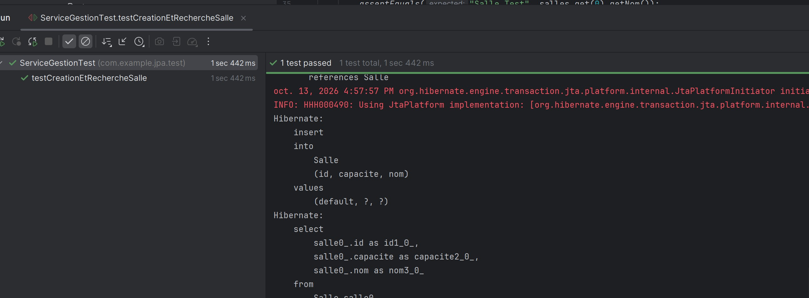
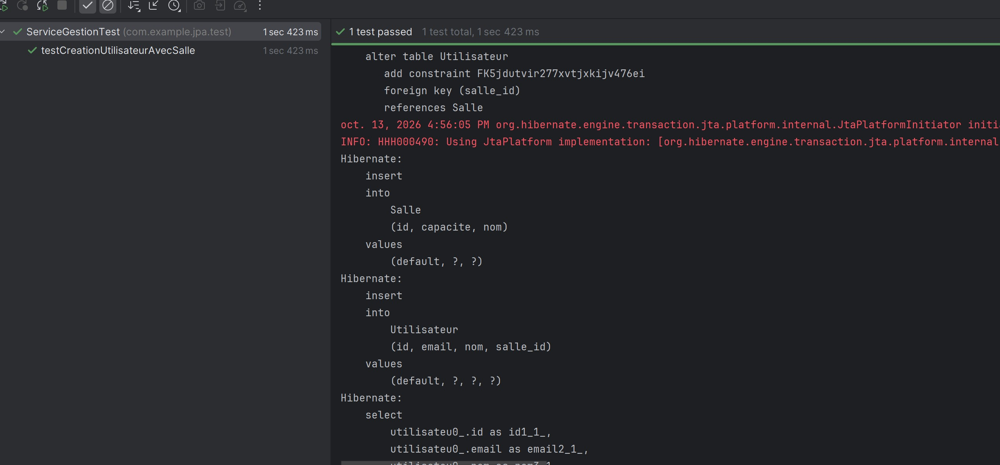
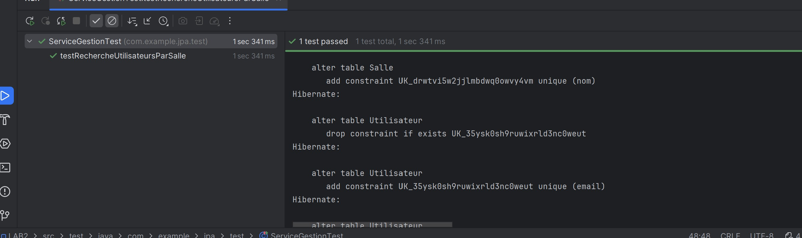
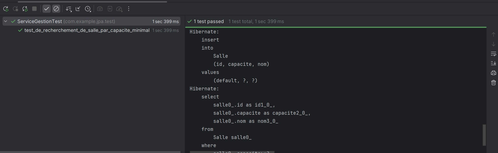
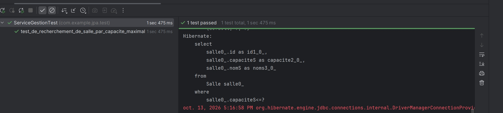

# Résultats des tests

## Image 1

Le test de création et de recherche d’une salle est réussi.

## Image 2

Le test de création d’un utilisateur associé à une salle est réussi.

## Image 3

Le test de recherche des utilisateurs d’une salle est réussi.

## Image 4

Le test de recherche des salles par capacité minimale est réussi.

## Image 5

Le test de recherche des salles par capacité maximale est réussi.

